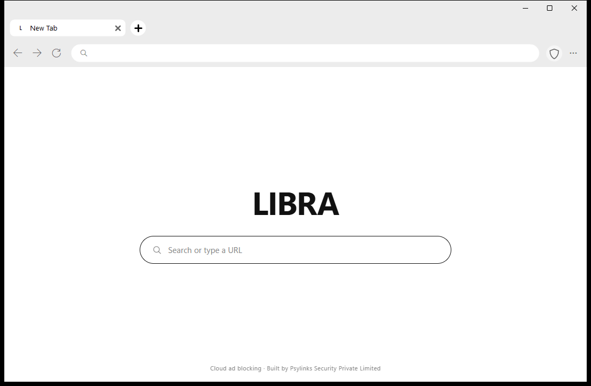
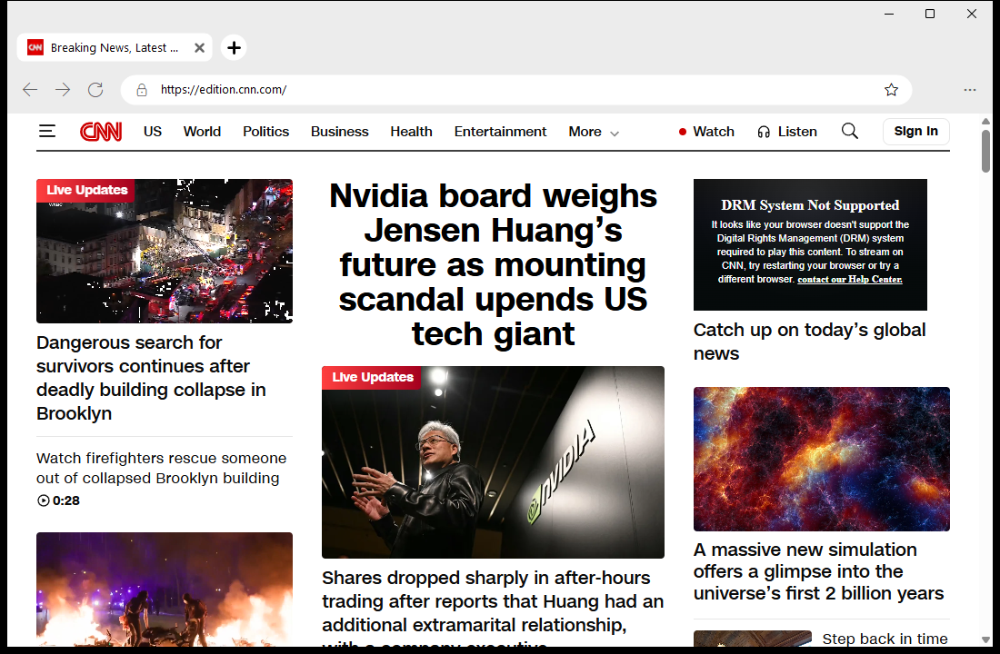

<p align="center"></p>

<h1 align="center">Libra Browser</h1>
<p align="center"><b>Libra Browser is a security-focused Windows browser: secure, private and lightweight. It blocks ads and trackers before they ever load.</b><br>
No account. No sync. No telemetry in Libra Browser's own code. Built by <b>Psylinks Security Private Limited</b>, an Indian company. Version 3.8.4 (beta), a private Windows browser with an optional AI browser agent.</p>


<p align="center"><a href="https://github.com/PsylinksSecurityWeb/libra-browser/releases"><strong>Download Libra Browser for Windows 10/11 (64-bit)</strong></a><br><sub>Installer and SHA-256 verification are on the release page. The beta is not code-signed yet.</sub></p>

<p align="center"><a href="https://github.com/PsylinksSecurityWeb/libra-browser">Source code</a> · <a href="https://github.com/PsylinksSecurityWeb/libra-browser/issues">Issues</a> · <a href="https://github.com/PsylinksSecurityWeb/libra-browser/security/advisories/new">Report a vulnerability</a></p>

> **Beta:** Libra Browser is still being built. Small errors can happen, and we improve it every day. The AI Agent is a beta feature too, so check its work before you submit anything important.
>
> **License:** open source under Apache-2.0. You may modify and redistribute it under the license terms; preserve the required copyright and NOTICE information. See [LICENSE](LICENSE).

## Why Libra Browser
- **Blocks ads and trackers at the DNS layer.** Every site name is looked up through our own DNS-over-HTTPS server, so trackers are refused *before* a connection exists. Less data, less CPU, faster pages.
- **Three levels per site:** Off, Balanced, Max, one tap from the shield icon. Fix a broken site without turning protection off everywhere.
- **Built for old and small PCs.** One small `.exe` on top of the Edge WebView2 runtime that Windows already uses, tab sleeping, a low-end mode, and a first-run animation that skips itself on weak machines.
- **Private by design.** No account, no cloud sync, no analytics, no tracking. Your history, bookmarks and passwords never leave the PC. The new-tab page can show a few clearly labelled *sponsored* links and a sponsored picture (see below); you can switch them off in one click.
- **Security defaults that matter:** popups need a real click, downloads started by a page without a click are refused, permissions default to *ask*, motion sensors are always blocked, https upgrade, fingerprint protection, Mark-of-the-Web on downloads.
- **Clean, flat, calm UI.** White canvas, no shadows, no clutter. Sponsored items are always labelled.

## Screenshots

Explore the browser before installing: the gallery shows the start page, privacy controls, search, settings, downloads, and the first-run experience.

| Start page | Privacy report |
|---|---|
|  |  |

| Settings | Browsing |
|---|---|
|  |  |


## Features
**Protection**
- Cloud ad and tracker blocking (DoH + blocklist), per-site Off / Balanced / Max, live counters and a 7-day protection report
- Empty ad-slot cleaner (removes the blank gaps ads leave behind)
- Path rules: ad banners on a site's own server (`/ads/banners/`, `_ads_banner.` file names, Flash files) are refused before they load, in Max mode only; a short reviewed list in `AdRules.h`, not a list of single words
- HTTPS upgrade with a clear "no secure connection" page; certificate errors cannot be bypassed silently
- Fingerprint protection (canvas, audio, hardware hints) that changes per site and per launch
- Optional third-party cookie blocking, autoplay blocking, popup blocker, drive-by download guard
- Microsoft SmartScreen on by default (switchable); permissions default to *ask*
- Private windows that leave no history, cookies or saved passwords

**Everyday**
- Address-bar and new-tab search suggestions from your chosen engine (Google, DuckDuckGo, Bing, Brave, Startpage, Ecosia, Perplexity, Brave Ask), plus local history and bookmark matches
- Editable home shortcuts (rename, change address, remove)
- Password vault (Windows DPAPI) with a strong password generator and tap-to-fill
- Fast downloads: segmented multi-connection, resume after failure, live speed
- **AI Agent (beta)**, off by default: bring your own API key; it can fill forms and read pages for you, asks before anything risky, never types passwords or card numbers, never solves CAPTCHAs. See [AGENT.md](AGENT.md)
- **Sponsored content (optional, off in one click):** up to 2 labelled tiles and one background picture on the new-tab page, hand-approved by us, no ad network and no tracking pixels. The browser fetches one signed list a day (no cookies, no ID, nothing about you); what is shown is chosen on your PC; the list is checked against a public key built into the app, so nobody else can push a link. Settings > Privacy > "Show sponsored content". Never shown in private windows or Child Safety mode.
- **Auto suggest (optional, no AI, this PC only):** click an empty name, e-mail, phone or company box and Libra offers the matching value from your own saved notes in its own popup; click it to type it. Opens only after a real click or Tab key, never for passwords, user names, cards or ID numbers, never on sign-in forms. See [AGENT.md](AGENT.md)
- "Clear browsing data": tick boxes and a time range; each kind is cleared and checked, anything left is swept again, and the result shows real numbers or what failed. Your API key, bookmarks and saved logins are never touched
- "Save videos" helper and right-click save for images, links and PDFs (off by default)
- History, Bookmarks, Downloads, Tabs manager, pinned tabs, Light mode, set as default browser

## How Libra Browser is different
| | **Libra Browser** | Chrome | Edge | Brave | Firefox | AVG Secure Browser |
|---|---|---|---|---|---|---|
| Engine | Chromium (WebView2) | Chromium | Chromium | Chromium | Gecko | Chromium |
| Ad/tracker blocking built in | Yes, DNS-level, 3 levels per site | No (extensions) | Tracking prevention | Yes (Shields) | Yes (Enhanced Tracking Protection) | Yes (ad blocker) |
| Account / sync needed | None, no sync at all | Optional | Optional | Optional | Optional | Not required |
| Telemetry in the app's own code | None | Yes, can be limited | Yes, can be limited | Minimal, can be limited | Yes, can be limited | See vendor policy |
| Source code | Source available (read-only) | Chromium open, Chrome closed | Closed | Open (MPL-2.0) | Open (MPL-2.0) | Closed |
| Extensions | No (by design) | Yes | Yes | Yes | Yes | Yes |
| Platforms | Windows 10/11 | All | All | All | All | Windows, macOS, mobile |
| Antivirus included | No | No | No | No | No | Sold alongside AVG products |

**Honest trade-offs.** Libra Browser is young and focused. It has no extensions, no sync and no mobile or macOS version. It is not an antivirus: it relies on SmartScreen and Windows Defender for file scanning. Because it runs on Microsoft's WebView2, engine security updates come through the WebView2 runtime, and that runtime keeps a background connection to Microsoft that Libra Browser cannot route (see [SECURITY-AUDIT.md](SECURITY-AUDIT.md)).

**Where Libra Browser wins:** a "security browser" you can *read*; protection that works before connections are made (so it also saves bandwidth and CPU); per-site control; and a deliberately small surface: nothing to sign in to, nothing to sync, and only labelled, switchable sponsored links.

*Competitor cells describe publicly documented features as we understand them; please check each vendor for current details.*

## What Libra Browser stores and contacts
| Where | What |
|---|---|
| `%LOCALAPPDATA%\LibraBrowser\` | settings, history, bookmarks, pinned tabs, DNS cache, home tiles, statistics, encrypted password vault, WebView2 profile (`UserData`). Private windows write none of this |
| Network: `dns.psylinks-beta.com` | DNS-over-HTTPS lookups (the blocking brain) |
| Network: your search engine | Search suggestions while typing (can be switched off) |
| Network: Microsoft | SmartScreen (switchable) and the WebView2 runtime's own background traffic (outside Libra Browser's control) |
| Registry (HKCU only) | Only when you press *Set as default browser* |
| Permissions | Runs as a normal user, no admin rights. The local proxy listens on `127.0.0.1` only. Camera, mic and location default to *ask* |

The full list of services and licenses is in [THIRD-PARTY-NOTICES.md](THIRD-PARTY-NOTICES.md).

## Developer guide
**Requirements:** Windows 10/11, Visual Studio Build Tools (MSVC + Windows SDK), and the Edge WebView2 Runtime. The NuGet packages (WebView2 SDK, WIL) are restored automatically.

**Build**
```bat
git clone https://github.com/PsylinksSecurityWeb/libra-browser.git
cd libra-browser/LibraBrowser
build.bat
```
Or open `LibraBrowser/LibraBrowser.vcxproj` and build **Release | x64**. Output: `LibraBrowser/x64/Release/LibraBrowser.exe` (one exe).

**Run and debug**
- Start the exe normally. For automation, launch with the environment variable `WEBVIEW2_ADDITIONAL_BROWSER_ARGUMENTS=--remote-debugging-port=9333`, then drive it with the Chrome DevTools Protocol.
- Automated tests are kept out of this public copy. Write your own against the debug port (Chrome DevTools Protocol).
- Internal pages (`libra://settings`, `history`, `privacy`, ...) are HTML strings built in C++ (`Pages.h`); open them from the address bar. Buttons use `data-c` / `data-a` and post a message handled in `OnPageMessage`.
- Settings are plain `key=value` lines in `settings.ini`.

**Code map (`LibraBrowser/src`)**
| File | Role |
|---|---|
| `main.cpp` | Entry point, single instance, command line (`--register-default`), URL hand-off |
| `BrowserWindow.cpp/.h` | Window, tabs, toolbar, WebView2 events, downloads hook-up, error pages, shield, suggestions |
| `Pages.h`, `PrivPage.h`, `PwPage.h` | All `libra://` pages and the first-run flow |
| `DohProxy.h` | Loopback HTTP/CONNECT proxy; every name resolved only via DoH; blocklist; rebinding protection |
| `AdBlocker.cpp/.h` | Local ad and tracker rules |
| `Downloader.h` | Segmented, resumable downloads; Mark-of-the-Web |
| `Vault.h`, `PwJs.h`, `PwSite.h`, `Passwords.inl` | Password vault (DPAPI), generator, autofill |
| `Fp.inl` | Fingerprint protection script and the daily changing identity |
| `Agent.inl`, `AgentPage.h`, `Voice.inl` | AI Agent (beta): chat panel, actions checked by native code, local voice input |
| `Sponsor.h`, `Sponsor.inl` | Sponsored content: signed-list check, daily fetch, tiles and background, hide |
| `Suggest.h`, `Suggest.inl`, `SgSite.h` | Auto suggest: notes matcher, popup, the small page script |
| `AdRules.h` | Path rules for ads on a site's own server (refused before the request is sent) |
| `Verdicts.h` | Local memory of blocked names (hashed, tamper-checked) |
| `Video.inl` | "Save videos" and right-click save |
| `Privacy.inl` | Clear data, default-browser registration |
| `Data.h` | Settings, search engines, history and bookmark types |
| `HeroAssets.h` | Generated: the first-run animation videos (byte arrays) |

**Add a search engine:** add a row to `kEngines` in `Data.h`; optionally add its suggestion URL in `SugEndpoint` in `BrowserWindow.cpp`.

**Conventions:** keep it small and light; animate transform and opacity only; no new network contact without a visible switch in Settings; never add telemetry.

## Roadmap
Settings groups and search, sensor and permission notices, offline spelling help, offline voice search, upstream proxy support for VPN and proxy users, code signing.

## FAQ
**Is it open source?** It is *source available*. The code is public to read, but modifying, redistributing or selling it needs written permission.

**Why not an extension like uBlock Origin?** Libra Browser blocks one level lower (DNS), needs no extension and uses less memory. Libra Browser has no extension system by design.

**Does it work on Windows 7 or XP?** No. WebView2 requires Windows 10 or newer.

**Does it collect my data?** Libra Browser's own code does not. See the table above for the optional services it can contact.

## Security
Report vulnerabilities privately through [GitHub security advisories](https://github.com/PsylinksSecurityWeb/libra-browser/security/advisories/new) or see [SECURITY.md](SECURITY.md). Audit notes: [SECURITY-AUDIT.md](SECURITY-AUDIT.md).

---
<sub>Built by Psylinks Security Private Limited (India). Other names are trademarks of their owners.</sub>
